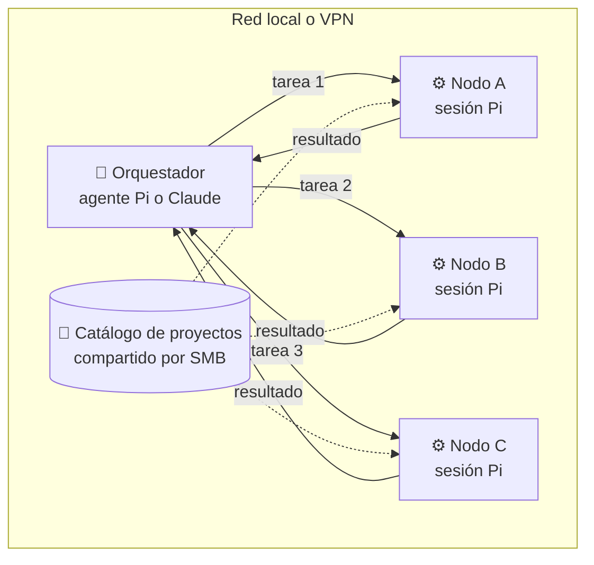
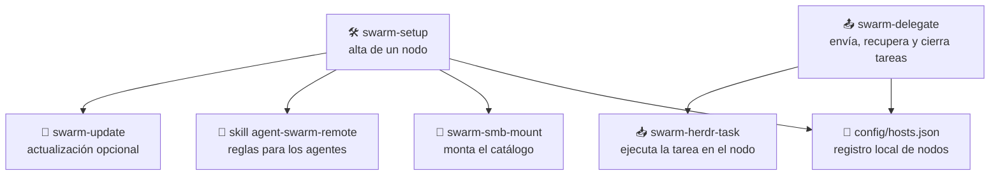
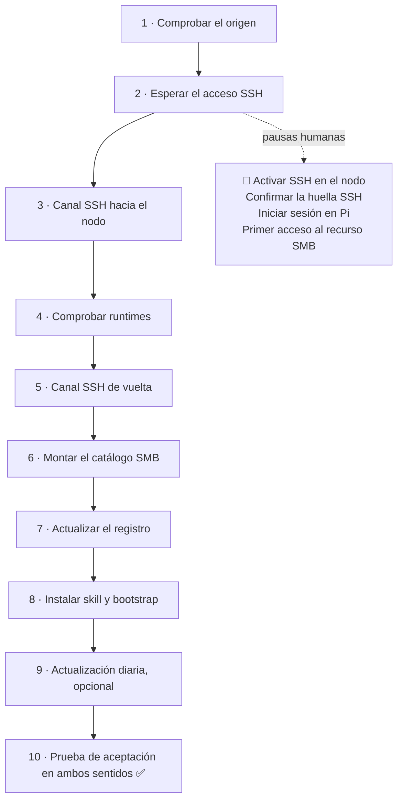
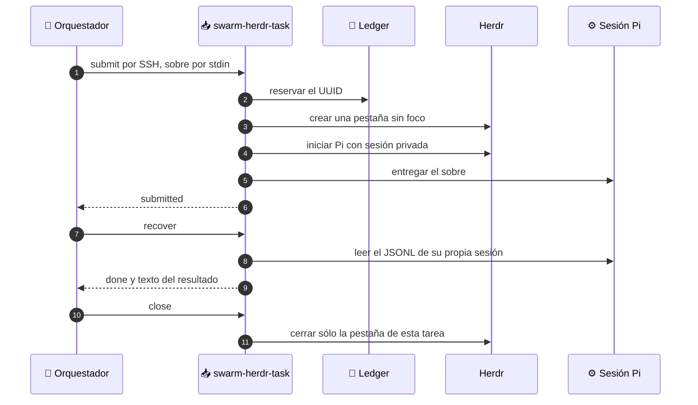
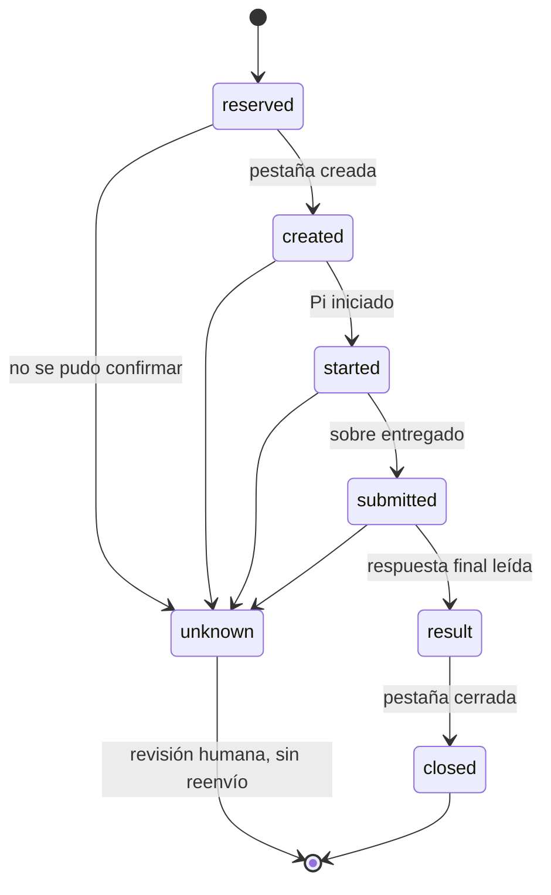

<div align="center">

# 🐝 Agent Swarm

**Conecta dos o más agentes de IA que trabajan en máquinas distintas de tu red local o VPN.**

Delega tareas al equipo que esté libre, aprovecha la potencia de cálculo que ya tienes
y deja que cada agente trabaje con sus propias herramientas, sin compartir credenciales.

[🇬🇧 English](README.md) · 🇪🇸 Español

</div>

---

## ✨ ¿Por qué Agent Swarm?

Tu portátil, el equipo de sobremesa y ese servidor que casi no usas tienen CPU, memoria y agentes listos para trabajar. Agent Swarm los convierte en un **enjambre**: cualquier agente puede pasarle una tarea a otro, seguir su progreso y recoger el resultado.

| | Ventaja |
| --- | --- |
| ⚡ **Más cómputo** | Envía builds, suites de tests o análisis largos a otra máquina y sigue trabajando en la tuya. |
| 🧭 **Orquestación y delegación** | Un agente coordina y otros ejecutan. Cada tarea lleva un objetivo y un criterio de aceptación verificables. |
| ⚖️ **Reparto de carga** | Varias tareas en paralelo, cada una en el nodo que elijas según su capacidad o disponibilidad. |
| 🔐 **Sin compartir identidades** | Sólo viaja un sobre de tarea. Las cuentas, credenciales, tokens y sesiones nunca salen de su máquina. |
| 🛟 **Tolerante a cortes** | Cada tarea tiene un UUID y un ledger durable. Si se corta la red, se recupera la misma tarea en lugar de lanzarla otra vez. |
| 🧩 **Agentes de verdad** | Cada tarea corre en una sesión real de [Pi](https://pi.dev) dentro de Herdr, visible y auditable en el nodo destino. |



## 🧠 La filosofía del enjambre

1. **Cada nodo es soberano.** Ninguna máquina copia el `HOME`, los llaveros, los tokens ni las sesiones de otra. Cada agente trabaja con su propia cuenta y sus propias herramientas.
2. **Se delega trabajo, no identidad.** El orquestador dice *qué* hay que conseguir y *cómo* se comprueba. El nodo decide *cómo* hacerlo.
3. **Ante la duda, se recupera; nunca se repite a ciegas.** Un estado ambiguo se conserva para revisarlo. Ninguna tarea se ejecuta dos veces por accidente.
4. **El humano manda.** Las huellas SSH, los inicios de sesión y las decisiones sobre trabajo concurrente siempre las toma una persona.

> [!NOTE]
> Agent Swarm es una capa de transporte y ciclo de vida, no un modelo de IA ni un sandbox. SSH abre una cuenta real y el sistema no bloquea dos tareas que escriban en el mismo proyecto.

## 🖥️ Plataformas

El protocolo sólo necesita herramientas Unix estándar: SSH, Python 3, un recurso SMB y Herdr con Pi. Por eso está pensado para cualquier sistema tipo Unix.

| Componente | macOS | Linux y otros Unix |
| --- | --- | --- |
| Delegación de tareas (`swarm-delegate`, `swarm-herdr-task`) | ✅ | Diseño portable; aún no validado |
| Alta automática (`swarm-setup`) | ✅ | Pendiente |
| Montaje SMB persistente (`swarm-smb-mount`) | ✅ usa Keychain y launchd | Pendiente: montar el recurso a mano |
| Actualización diaria (`swarm-update`) | ✅ usa launchd | Pendiente |

## 🧱 Piezas



| Pieza | Para qué sirve |
| --- | --- |
| `config/hosts.json` | Indica qué nodos existen, cómo llegar a cada uno y dónde está el catálogo. Se crea desde `config/hosts.example.json` y Git lo ignora. |
| `swarm-setup` | Incorpora un nodo en fases que se pueden reanudar. |
| `swarm-delegate` | Herramienta del orquestador: `list`, `self`, `preflight`, `submit`, `recover` y `close`. |
| `swarm-herdr-task` | Adaptador del nodo: abre una pestaña y una sesión Pi propias, guarda el ledger y lee el resultado. |
| `swarm-smb-mount` | Monta sólo el recurso compartido registrado, con las credenciales locales del nodo. |
| `swarm-update` | Comprueba e instala actualizaciones de las herramientas, sin `sudo`. |
| `skills/agent-swarm-remote` | Enseña a Pi y a Claude a delegar o recibir un sobre sin salirse del contrato. |

Cada nodo tiene uno de dos roles: el **hub** publica el catálogo de proyectos por SMB y los **spokes** lo montan para trabajar sobre los mismos proyectos.

## 🚀 Puesta en marcha

### 1. Prepara el registro

En un nodo que ya tenga el repositorio:

```sh
cp config/hosts.example.json config/hosts.json
# Edita hub, share y la entrada de cada nodo con sus valores reales.
```

### 2. Incorpora cada nodo

Desde un nodo ya registrado:

```sh
automation/agent-swarm/bin/swarm-setup add-host \
  --name spoke-node --address spoke-node.local --user your-user \
  --install-missing --no-auto-update
```

Quita `--no-auto-update` si quieres la actualización diaria. Si el comando se detiene esperando una acción, hazla y **vuelve a ejecutar el mismo comando**: continúa desde la fase pendiente.



Esas pausas son intencionales: una persona confirma la huella y escribe las credenciales en la máquina que corresponde. Ninguna credencial se copia entre nodos.

### 3. Comprueba que funciona

```sh
automation/agent-swarm/bin/swarm-delegate list
automation/agent-swarm/bin/swarm-delegate preflight spoke-node
# {"status": "ready", "target": "spoke-node"}
```

Si un spoke responde `catalog_missing`, monta el catálogo antes de enviarle trabajo. La [guía de validación](docs/runbooks/agent-swarm/validation.md) reúne todas las comprobaciones.

## 📦 Envía tu primera tarea

Una tarea es un sobre JSON con exactamente seis campos:

```json
{
  "task_id": "3f6c2a2e-8d0b-4a8e-9a63-1f5b0c2d7e11",
  "origin_host": "hub-node",
  "project": "my-project",
  "goal": "Run the test suite and summarize the failures.",
  "acceptance": "A list of failing tests with their likely cause.",
  "mode": "executor"
}
```

```sh
B=automation/agent-swarm/bin
$B/swarm-delegate submit  spoke-node < task.json
$B/swarm-delegate recover spoke-node 3f6c2a2e-8d0b-4a8e-9a63-1f5b0c2d7e11 --wait 300
$B/swarm-delegate close   spoke-node 3f6c2a2e-8d0b-4a8e-9a63-1f5b0c2d7e11
```

`project` siempre es relativo al catálogo del nodo destino. Los secretos nunca van dentro del sobre.

En el día a día no hace falta escribir estos comandos: con la skill instalada, basta con pedirle a tu agente algo como *«delega los tests a spoke-node»*.

### Qué pasa por dentro



Antes de cada efecto, el ledger anota la intención. Así, una tarea interrumpida nunca queda en un estado inventado:



Si recibes `unknown`, vuelve a consultar con `recover` y el mismo UUID. Si no cambia, revisa la pestaña en el nodo destino antes de decidir. Nunca crees otro UUID para el mismo trabajo.

## 🔐 Seguridad

- **SSH:** un alias `swarm-<nodo>` y una clave dedicada por sentido, con `StrictHostKeyChecking` activo y sin reenvío de agente ni de puertos.
- **SMB:** sólo se comparte el catálogo aprobado, y las credenciales se guardan en el almacén local del nodo que lo monta.
- **Agentes:** las sesiones y credenciales de Pi y Herdr nunca salen del nodo que los ejecuta.
- **Limpieza:** cada nodo sólo cierra las pestañas y sesiones que él mismo creó.
- **Escritura concurrente:** no se coordina de forma automática. Si dos tareas tocan el mismo proyecto, la revisión es humana.

## 📚 Documentación

| Si quieres... | Lee |
| --- | --- |
| Entender el diseño completo | [Arquitectura](docs/architecture.md) |
| Incorporar un nodo paso a paso | [Instalación guiada](docs/setup/agent-guided-setup.md) y [Agregar un equipo](docs/setup/add-host.md) |
| Conocer el contrato de tareas | [Tareas Herdr + Pi](docs/runbooks/agent-swarm/herdr-tasks.md) |
| Comprobar un despliegue | [Validación](docs/runbooks/agent-swarm/validation.md) |
| Revisar SSH o SMB | [Canal SSH](docs/runbooks/agent-swarm/ssh-channel.md) y [Montaje SMB](docs/runbooks/agent-swarm/smb-mount.md) |
| Retirar un nodo | [Reversión](docs/runbooks/agent-swarm/rollback.md) |
| Ver qué se probó y qué no | [Evidencia de pruebas](docs/runbooks/agent-swarm/test-evidence.md) |
| Consultar las reglas del agente | [Skill remota](skills/agent-swarm-remote/SKILL.md) |
| Leer el diseño de delegación por carga y MCP | [Diseño de la funcionalidad](docs/features/load-aware-delegation-mcp.md) |

## 🗺️ TODO

Lo que todavía no está hecho y hacia dónde va el proyecto:

- [ ] **Reparto automático por carga.** Si la CPU o la RAM de la máquina local superan un umbral configurable (por ejemplo, 85%), delegar la tarea en el nodo menos cargado que pase `preflight`. Empezará como una opción explícita (`target: auto`), no como comportamiento por defecto, porque dos tareas automáticas podrían escribir en el mismo proyecto. Seguimiento en la [issue #1](https://github.com/LeonardoX77/agent-swarm/issues/1).
- [ ] **Métricas de carga por nodo.** Exponer CPU y memoria de cada nodo con herramientas estándar de Unix (`uptime`, `/proc/meminfo` en Linux, `vm_stat` en macOS) para que el reparto automático pueda decidir.
- [ ] **Servidor MCP.** Publicar `list_nodes`, `check_node`, `submit_task`, `get_task`, `close_task` y `node_load` como herramientas MCP. Será un servidor local por stdio que envuelve `swarm-delegate`, mantiene SSH como transporte, no bloquea en tareas largas, nunca reintenta en automático y pide aprobación humana para `submit_task`.
- [ ] **Probar en Linux.** La delegación de tareas está pensada para ser portable, pero sólo se ha validado en macOS.
- [ ] **Quitar la dependencia de macOS.** `swarm-smb-mount` y `swarm-update` usan launchd, Keychain y `osascript`, que sólo existen en macOS. Faltan alternativas para Linux, por ejemplo `mount.cifs` con un archivo de credenciales protegido y un timer de systemd.
- [ ] **Alta automática en Linux.** `swarm-setup` aún asume las rutas y servicios de macOS.
- [ ] **Posible carrera al arrancar Pi.** En una prueba real, la aceptación devolvió `unknown` porque la sesión de Pi se evaluó antes de estar lista; repetirla funcionó. Falta una prueba determinista que lo reproduzca antes de corregir el adaptador. Los detalles están en la [evidencia de pruebas](docs/runbooks/agent-swarm/test-evidence.md).

## 🤝 Colaborar

Agent Swarm es un proyecto abierto y cualquier ayuda suma, sobre todo con los puntos del TODO. Hay dos maneras de participar.

### 1. Pull request (recomendado)

1. Haz un fork de [LeonardoX77/agent-swarm](https://github.com/LeonardoX77/agent-swarm) y crea una rama para tu cambio.
2. Mantén el cambio acotado: una funcionalidad o una corrección por PR, con sus pruebas y su documentación.
3. Ejecuta las pruebas antes de enviarlo:

   ```sh
   python3 -m unittest discover -s automation/agent-swarm/test
   ```

4. Usa mensajes de commit con formato [Conventional Commits](https://www.conventionalcommits.org/) y explica en la PR qué cambia, por qué y cómo lo probaste.
5. Nunca incluyas tu `config/hosts.json`, claves, huellas reales ni credenciales.

### 2. Issue

Si encontraste un fallo o tienes una idea pero no vas a implementarla, [abre una issue](https://github.com/LeonardoX77/agent-swarm/issues/new). Para un fallo, incluye el sistema operativo de cada nodo, el comando que ejecutaste, la salida obtenida y la esperada. Elimina antes nombres de máquinas, usuarios y rutas privadas.
