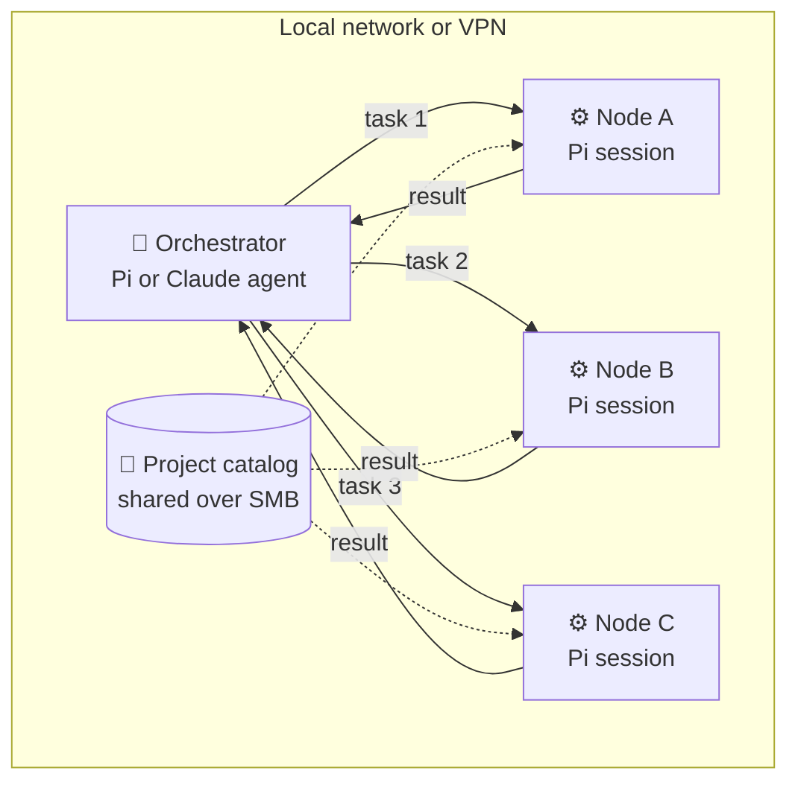
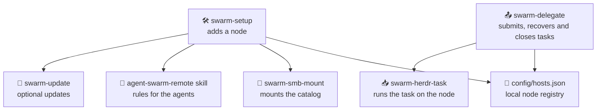
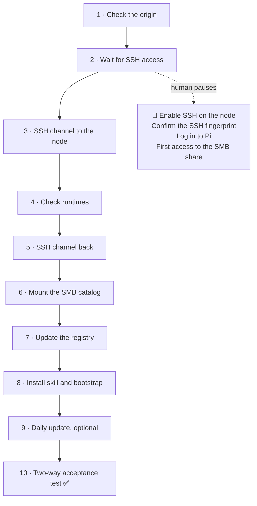
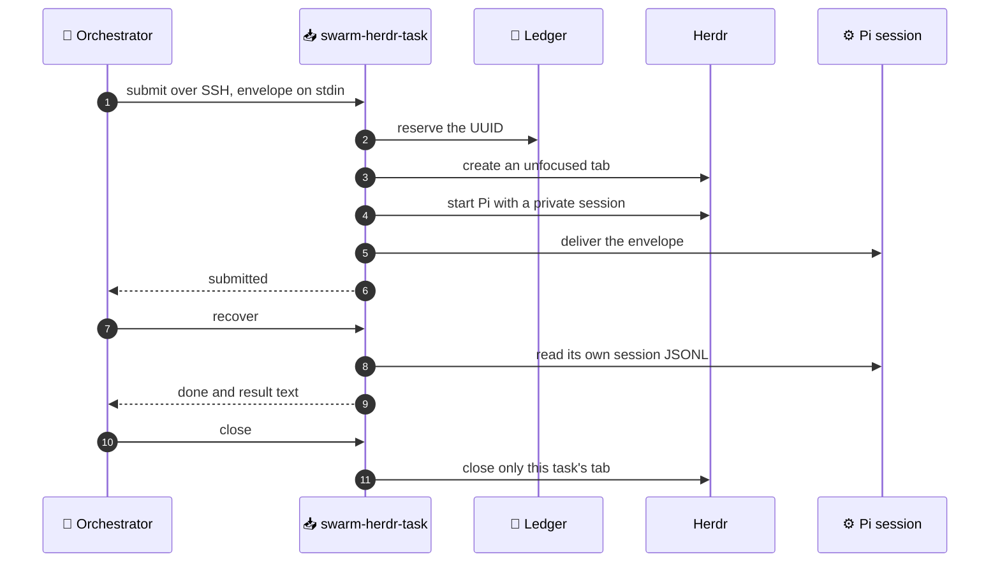
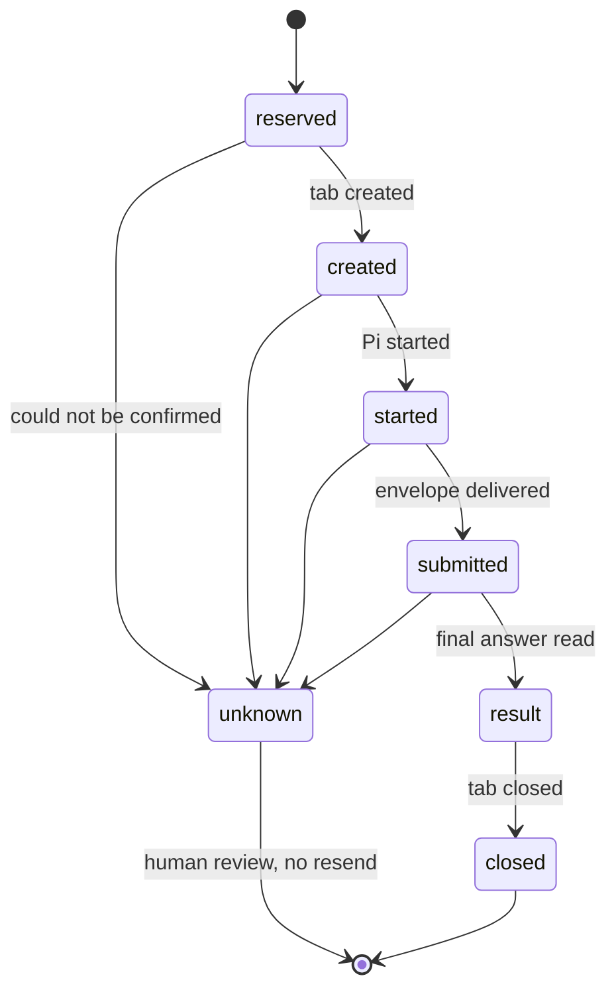

<div align="center">

# 🐝 Agent Swarm

**Connect two or more AI agents running on different machines across your local network or VPN.**

Delegate tasks to whichever machine is free, put the compute you already own to work,
and let each agent use its own tools without ever sharing credentials.

🇬🇧 English · [🇪🇸 Español](README-ES.md)

</div>

---

## ✨ Why Agent Swarm?

Your laptop, your desktop and that server you barely touch all have CPU, memory and agents ready to work. Agent Swarm turns them into a **swarm**: any agent can hand a task to another one, follow its progress and collect the result.

| | Advantage |
| --- | --- |
| ⚡ **More compute** | Send builds, test suites or long analyses to another machine and keep working on yours. |
| 🧭 **Orchestration and delegation** | One agent coordinates while others execute. Every task carries a goal and verifiable acceptance criteria. |
| ⚖️ **Load spreading** | Run several tasks in parallel, each on the node you choose based on its capacity or availability. |
| 🔐 **No shared identities** | Only a task envelope travels. Accounts, credentials, tokens and sessions never leave their machine. |
| 🛟 **Resilient to outages** | Every task has a UUID and a durable ledger. If the network drops, the same task is recovered instead of being launched again. |
| 🧩 **Real agents** | Each task runs in a real [Pi](https://pi.dev) session inside Herdr, visible and auditable on the target node. |



## 🧠 The swarm philosophy

1. **Every node is sovereign.** No machine copies another one's `HOME`, keychains, tokens or sessions. Each agent works with its own account and its own tools.
2. **Delegate work, not identity.** The orchestrator says *what* has to be achieved and *how it is checked*. The node decides *how* to do it.
3. **When in doubt, recover; never blindly repeat.** An ambiguous state is kept for review. No task is run twice by accident.
4. **The human is in charge.** SSH fingerprints, logins and decisions about concurrent work are always made by a person.

> [!NOTE]
> Agent Swarm is a transport and lifecycle layer, not an AI model or a sandbox. SSH opens a real account, and the system does not prevent two tasks from writing to the same project.

## 🖥️ Platforms

The protocol only needs standard Unix tools: SSH, Python 3, an SMB share, and Herdr with Pi. It is therefore designed for any Unix-like system.

| Component | macOS | Linux and other Unix |
| --- | --- | --- |
| Task delegation (`swarm-delegate`, `swarm-herdr-task`) | ✅ | Portable by design; not validated yet |
| Automated setup (`swarm-setup`) | ✅ | Pending |
| Persistent SMB mount (`swarm-smb-mount`) | ✅ uses Keychain and launchd | Pending: mount the share by hand |
| Daily update (`swarm-update`) | ✅ uses launchd | Pending |

## 🧱 Components



| Component | What it does |
| --- | --- |
| `config/hosts.json` | Says which nodes exist, how to reach each one and where the catalog lives. Created from `config/hosts.example.json` and ignored by Git. |
| `swarm-setup` | Adds a node in resumable phases. |
| `swarm-delegate` | The orchestrator's tool: `list`, `self`, `preflight`, `submit`, `recover` and `close`. |
| `swarm-herdr-task` | The node's adapter: opens its own tab and Pi session, keeps the ledger and reads the result. |
| `swarm-smb-mount` | Mounts only the registered share, using the node's local credentials. |
| `swarm-update` | Checks for and installs tool updates, without `sudo`. |
| `skills/agent-swarm-remote` | Teaches Pi and Claude to delegate or receive an envelope without leaving the contract. |

Each node has one of two roles: the **hub** publishes the project catalog over SMB, and **spokes** mount it to work on the same projects.

## 🚀 Getting started

### 1. Prepare the registry

On a node that already has the repository:

```sh
cp config/hosts.example.json config/hosts.json
# Edit hub, share and each node's entry with your real values.
```

### 2. Add each node

From an already registered node:

```sh
automation/agent-swarm/bin/swarm-setup add-host \
  --name spoke-node --address spoke-node.local --user your-user \
  --install-missing --no-auto-update
```

Drop `--no-auto-update` if you want the daily update. If the command stops waiting for an action, do it and **run the same command again**: it continues from the pending phase.



These pauses are intentional: a person confirms the fingerprint and types the credentials on the right machine. No credential is ever copied between nodes.

### 3. Check that it works

```sh
automation/agent-swarm/bin/swarm-delegate list
automation/agent-swarm/bin/swarm-delegate preflight spoke-node
# {"status": "ready", "target": "spoke-node"}
```

If a spoke answers `catalog_missing`, mount the catalog before sending it work. The [validation guide](docs/runbooks/agent-swarm/validation.md) lists every check.

## 📦 Send your first task

A task is a JSON envelope with exactly six fields:

```json
{
  "task_id": "3f6c2a2e-8d0b-4a8e-9a63-1f5b0c2d7e11",
  "origin_host": "hub-node",
  "project": "my-project",
  "goal": "Run the test suite and summarize the failures.",
  "acceptance": "A list of failing tests with their likely cause.",
  "mode": "executor"
}
```

```sh
B=automation/agent-swarm/bin
$B/swarm-delegate submit  spoke-node < task.json
$B/swarm-delegate recover spoke-node 3f6c2a2e-8d0b-4a8e-9a63-1f5b0c2d7e11 --wait 300
$B/swarm-delegate close   spoke-node 3f6c2a2e-8d0b-4a8e-9a63-1f5b0c2d7e11
```

`project` is always relative to the target node's catalog. Secrets never go inside the envelope.

Day to day you do not need to type these commands: with the skill installed, just ask your agent something like *"delegate the tests to spoke-node"*.

### What happens inside



Before every effect, the ledger records the intent. An interrupted task therefore never ends up in an invented state:



If you get `unknown`, query again with `recover` and the same UUID. If nothing changes, inspect the tab on the target node before deciding. Never create another UUID for the same job.

## 🔐 Security

- **SSH:** one `swarm-<node>` alias and one dedicated key per direction, with `StrictHostKeyChecking` on and no agent or port forwarding.
- **SMB:** only the approved catalog is shared, and credentials are stored in the local credential store of the node that mounts it.
- **Agents:** Pi and Herdr sessions and credentials never leave the node that runs them.
- **Cleanup:** each node only closes the tabs and sessions it created itself.
- **Concurrent writes:** not coordinated automatically. If two tasks touch the same project, review is human.

## 📚 Documentation

The detailed documentation under `docs/` is written in Spanish.

| If you want to... | Read |
| --- | --- |
| Understand the full design | [Architecture](docs/architecture.md) |
| Add a node step by step | [Guided setup](docs/setup/agent-guided-setup.md) and [Add a host](docs/setup/add-host.md) |
| Learn the task contract | [Herdr + Pi tasks](docs/runbooks/agent-swarm/herdr-tasks.md) |
| Check a deployment | [Validation](docs/runbooks/agent-swarm/validation.md) |
| Review SSH or SMB | [SSH channel](docs/runbooks/agent-swarm/ssh-channel.md) and [SMB mount](docs/runbooks/agent-swarm/smb-mount.md) |
| Remove a node | [Rollback](docs/runbooks/agent-swarm/rollback.md) |
| See what was tested and what was not | [Test evidence](docs/runbooks/agent-swarm/test-evidence.md) |
| Read the agent's rules | [Remote skill](skills/agent-swarm-remote/SKILL.md) |
| Read the load-aware delegation and MCP design | [Feature design](docs/features/load-aware-delegation-mcp.md) |

## 🗺️ TODO

What is not done yet and where the project is heading:

- [ ] **Load-aware automatic delegation.** If the local machine's CPU or RAM exceeds a configurable threshold (for example, 85%), delegate the task to the least loaded node that passes `preflight`. It will start as an explicit option (`target: auto`), not as the default behavior, because two automatic tasks could write to the same project. Tracked in [issue #1](https://github.com/LeonardoX77/agent-swarm/issues/1).
- [ ] **Per-node load metrics.** Expose each node's CPU and memory using standard Unix tools (`uptime`, `/proc/meminfo` on Linux, `vm_stat` on macOS) so automatic delegation can decide.
- [ ] **MCP server.** Publish `list_nodes`, `check_node`, `submit_task`, `get_task`, `close_task` and `node_load` as MCP tools. It will be a local stdio server wrapping `swarm-delegate`, keeping SSH as the transport, never blocking on long tasks, never retrying automatically and requiring human approval for `submit_task`.
- [ ] **Test on Linux.** Task delegation is meant to be portable, but it has only been validated on macOS.
- [ ] **Remove the macOS dependency.** `swarm-smb-mount` and `swarm-update` use launchd, Keychain and `osascript`, which only exist on macOS. Linux alternatives are missing, for example `mount.cifs` with a protected credentials file and a systemd timer.
- [ ] **Automated setup on Linux.** `swarm-setup` still assumes macOS paths and services.
- [ ] **Possible race when Pi starts.** In a real run, acceptance returned `unknown` because the Pi session was evaluated before it was ready; running it again worked. A deterministic test that reproduces it is needed before fixing the adapter. Details are in the [test evidence](docs/runbooks/agent-swarm/test-evidence.md).

## 🤝 Contributing

Agent Swarm is an open project and any help counts, especially with the TODO items. There are two ways to take part.

### 1. Pull request (recommended)

1. Fork [LeonardoX77/agent-swarm](https://github.com/LeonardoX77/agent-swarm) and create a branch for your change.
2. Keep the change focused: one feature or fix per PR, with its tests and documentation.
3. Run the tests before submitting:

   ```sh
   python3 -m unittest discover -s automation/agent-swarm/test
   ```

4. Use [Conventional Commits](https://www.conventionalcommits.org/) messages and explain in the PR what changes, why, and how you tested it.
5. Never include your `config/hosts.json`, keys, real fingerprints or credentials.

### 2. Issue

If you found a bug or have an idea but will not implement it, [open an issue](https://github.com/LeonardoX77/agent-swarm/issues/new). For a bug, include each node's operating system, the command you ran, the output you got and the expected one. Remove machine names, usernames and private paths first.
