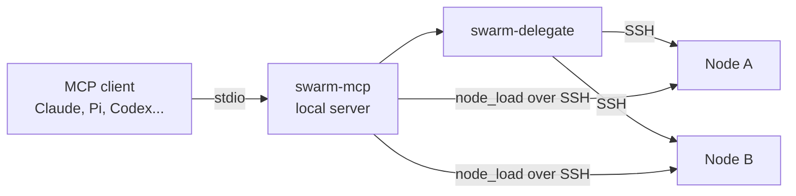
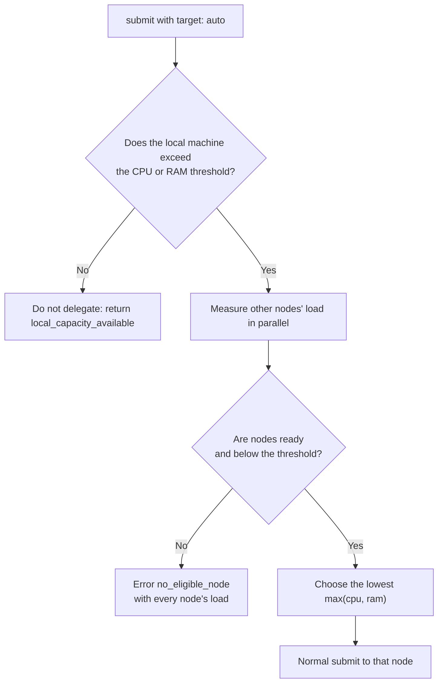

# Load-aware delegation and MCP server

> **Status:** design proposal; not implemented.
> **Scope:** automatic task distribution based on CPU and RAM load, plus an MCP server that exposes Agent Swarm as tools.

## Problem

Today, the person submitting a task always chooses its destination node. When the local machine is saturated, the agent cannot know that or find an available node. Delegation also requires the `agent-swarm-remote` skill and running `swarm-delegate` from a shell, so only agents that know the skill can use the swarm.

## Goals

1. Delegate automatically to the least-loaded node when the local machine exceeds a CPU or RAM threshold.
2. Expose Agent Swarm as typed MCP tools usable by any MCP client (Claude Code, Pi with `pi-mcp-adapter`, Codex, Cursor).
3. Preserve current guarantees: one UUID per task, a durable ledger, no blind resend, and no shared credentials.

## Out of scope

- A remote MCP server exposed on the network. Inter-node transport remains SSH.
- Queue scheduling, priorities, or preference for one node over another.
- Coordination of concurrent writers on one project.
- Linux support for `swarm-smb-mount`, `swarm-update`, and `swarm-setup`. That is separate work, although this design's metrics must already be portable.

## Requirements

| ID | Requirement |
| --- | --- |
| R1 | Each node reports CPU and RAM use with standard Unix tools, without `sudo` or new dependencies. |
| R2 | The threshold is configurable in `config/hosts.json`, defaulting to 85% for CPU and RAM. |
| R3 | With `target: auto`, if the local machine exceeds either threshold, the task is delegated to the least-loaded node that returns `ready` to `preflight` and is below the threshold. |
| R4 | If the local machine does not exceed a threshold, `target: auto` does not delegate and reports that fact; the local agent keeps the task. |
| R5 | If no node is eligible, nothing is sent and an explicit error returns every node's load. |
| R6 | Automatic delegation is optional and explicit (`target: auto`); it is never the default. |
| R7 | The MCP server exposes `list_nodes`, `check_node`, `node_load`, `submit_task`, `get_task`, and `close_task`. |
| R8 | No MCP tool blocks for the entire task: `submit_task` returns the UUID and `get_task` waits only a bounded time. |
| R9 | The MCP server never retries `submit` itself; on ambiguity it returns `unknown` and the UUID for recovery. |
| R10 | Every response identifies the selected node and why, including observed load. |

## Design

### Overview



The MCP server is a thin wrapper. It does not reimplement transport: it calls the same functions as `swarm-delegate` and retains their validation.

### Load metrics

A new `swarm-delegate load <node>` action (and `load self`) returns uniform JSON:

```json
{"node": "spoke-node", "cpu_percent": 42.0, "ram_percent": 71.5, "cpus": 8, "sampled_at": "2026-10-28T10:00:00Z"}
```

| Metric | Linux | macOS |
| --- | --- | --- |
| CPU | One-minute load average (`/proc/loadavg`) divided by CPU count | `os.getloadavg()` divided by `os.cpu_count()` |
| RAM | `1 - MemAvailable / MemTotal` from `/proc/meminfo` | Active, wired, and compressed `vm_stat` pages against `hw.memsize` |

The calculation belongs in a shared-library Python module, with one implementation per platform and tests using fixed command output. Load average can exceed 100%; report it unchanged and compare it with the threshold without clamping.

### Configuration

```json
{
  "load_policy": {
    "cpu_threshold_percent": 85,
    "ram_threshold_percent": 85,
    "sample_timeout_seconds": 10
  }
}
```

`load_policy` is optional and lives at the root of `config/hosts.json`. If absent, defaults apply. A value outside 1–100 invalidates the registry, just as any other invalid field does today.

### Selection policy



Break ties alphabetically by node name so selection is reproducible. A node that does not respond in time is excluded and included in the response with its reason.

### MCP tools

| Tool | Input | Output |
| --- | --- | --- |
| `list_nodes` | none | Registered nodes, role, and local node. |
| `check_node` | `node` | `preflight` result. |
| `node_load` | `node` or `all` | Load for one or all nodes. |
| `submit_task` | `target` (name or `auto`), `project`, `goal`, `acceptance`, optional `task_id` | `task_id`, selected node, reason, and state. |
| `get_task` | `node`, `task_id`, `wait_seconds` (0–120) | State and, when finished, result text. |
| `close_task` | `node`, `task_id` | Confirmation that the own tab closed. |

`submit_task` generates the UUID if the client does not supply it and always returns it, including on failure. The server fills `origin_host` and `mode: executor`; clients cannot alter them.

Implement the server in Python using the standard library (JSON-RPC over stdio) to avoid adding dependencies to nodes. If the protocol becomes too costly, evaluate the official MCP SDK as a dependency only on the origin node.

## Security

- `submit_task` starts an agent with real access on another machine. Documentation will recommend not auto-approving it in the MCP client.
- The server listens only on stdio; it opens no ports.
- Metrics use the same restricted SSH channel and expose no processes, users, or paths.
- `project`, `goal`, and `acceptance` pass the current envelope validation.

## Risks

| Risk | Mitigation |
| --- | --- |
| Two automatic tasks write to the same project. | `target: auto` is explicit and the response names the node; coordination remains human. |
| Load changes between measurement and submission. | Accepted: selection is advisory and the response includes the sample used. |
| Measuring every node delays submission. | Parallel measurements with `sample_timeout_seconds`. |
| An MCP client retries `submit_task` after a timeout. | If it reuses the same `task_id`, the ledger returns the existing state; documentation says not to generate another. |

## Phased plan

| Phase | Delivery | Tests |
| --- | --- | --- |
| 1 | Metrics module and `swarm-delegate load`. | Fixed `/proc` and `vm_stat` output; nonresponsive node. |
| 2 | `load_policy` in the registry and `target: auto` in `swarm-delegate submit`. | Threshold not exceeded, least-loaded choice, tie, no eligible node, invalid values. |
| 3 | `swarm-mcp` server with all six tools. | JSON-RPC contract per tool, no retries, bounded wait. |
| 4 | Updated documentation, skill, and README TODO. | Review examples using a real MCP client. |

## Open questions

1. Should the threshold consider sustained load, such as a five-minute average, instead of one minute?
2. Should specific nodes, such as a battery-powered laptop, be excluded from distribution?
3. Is a per-node concurrent-task limit needed in addition to load?
