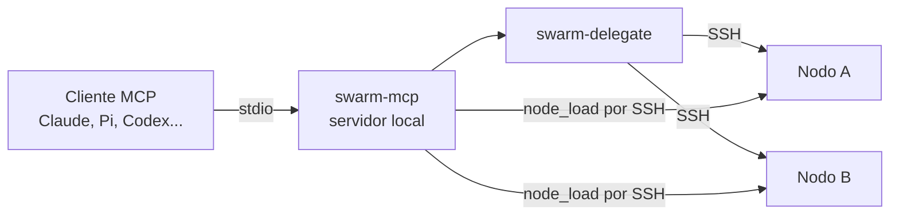
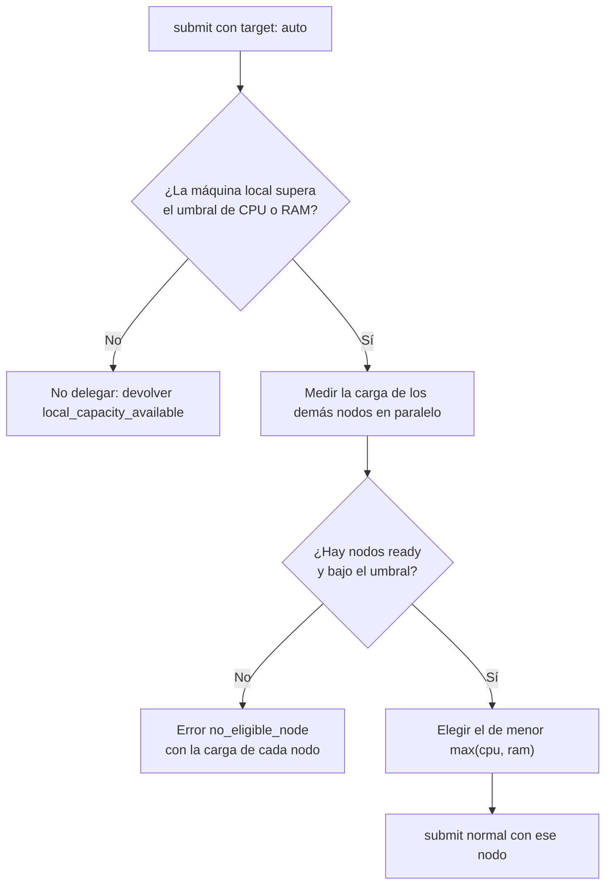

# Delegación por carga y servidor MCP

> **Estado:** propuesta de diseño, sin implementar.
> **Alcance:** reparto automático de tareas según la carga de CPU y RAM, y un servidor MCP que expone Agent Swarm como herramientas.

## Problema

Hoy quien envía una tarea elige siempre el nodo destino. Si la máquina local está saturada, el agente no tiene forma de saberlo ni de buscar un nodo libre. Además, para delegar hace falta la skill `agent-swarm-remote` y ejecutar `swarm-delegate` por shell, así que sólo los agentes que conocen esa skill pueden usar el enjambre.

## Objetivos

1. Delegar automáticamente en el nodo menos cargado cuando la máquina local supere un umbral de uso de CPU o RAM.
2. Exponer Agent Swarm como herramientas MCP tipadas, utilizables por cualquier cliente MCP (Claude Code, Pi con `pi-mcp-adapter`, Codex, Cursor).
3. Mantener todas las garantías actuales: UUID por tarea, ledger durable, ningún reenvío ciego y ninguna credencial compartida.

## Fuera de alcance

- Un MCP remoto expuesto en la red. El transporte entre nodos sigue siendo SSH.
- Planificación de colas, prioridades o preferencia de un nodo sobre otro.
- Coordinación de escritores concurrentes sobre un mismo proyecto.
- Soporte de Linux para `swarm-smb-mount`, `swarm-update` y `swarm-setup`. Es un trabajo aparte, aunque las métricas de este diseño ya deben ser portables.

## Requisitos

| ID | Requisito |
| --- | --- |
| R1 | Cada nodo informa su uso de CPU y RAM con herramientas estándar de Unix, sin `sudo` ni dependencias nuevas. |
| R2 | El umbral es configurable en `config/hosts.json`, con un valor por defecto del 85% para CPU y para RAM. |
| R3 | Con `target: auto`, si la máquina local supera cualquiera de los dos umbrales, la tarea se delega en el nodo con menos carga entre los que responden `ready` a `preflight` y están por debajo del umbral. |
| R4 | Si la máquina local no supera el umbral, `target: auto` no delega y lo informa; la tarea queda en manos del agente local. |
| R5 | Si ningún nodo es elegible, no se envía nada y se devuelve un error explícito con la carga de cada nodo. |
| R6 | La delegación automática es opcional y explícita (`target: auto`); nunca es el comportamiento por defecto. |
| R7 | El servidor MCP expone `list_nodes`, `check_node`, `node_load`, `submit_task`, `get_task` y `close_task`. |
| R8 | Ninguna herramienta MCP bloquea durante toda la tarea: `submit_task` devuelve el UUID y `get_task` espera como máximo un tiempo acotado. |
| R9 | El servidor MCP nunca reintenta un `submit` por su cuenta; ante un resultado ambiguo devuelve `unknown` y el UUID para recuperarlo. |
| R10 | Todas las respuestas indican qué nodo se eligió y por qué, incluida la carga observada. |

## Diseño

### Vista general



El servidor MCP es un envoltorio fino. No reimplementa el transporte: llama a las mismas funciones que `swarm-delegate` y conserva sus validaciones.

### Métricas de carga

Una nueva acción `swarm-delegate load <nodo>` (y `load self`) devuelve un JSON uniforme:

```json
{"node": "spoke-node", "cpu_percent": 42.0, "ram_percent": 71.5, "cpus": 8, "sampled_at": "2026-10-28T10:00:00Z"}
```

| Métrica | Linux | macOS |
| --- | --- | --- |
| CPU | Carga media de 1 minuto (`/proc/loadavg`) dividida por el número de CPU | `os.getloadavg()` dividida por `os.cpu_count()` |
| RAM | `1 - MemAvailable / MemTotal` de `/proc/meminfo` | Páginas activas, cableadas y comprimidas de `vm_stat` frente a `hw.memsize` |

El cálculo vive en un módulo Python de la biblioteca compartida, con una implementación por plataforma y pruebas con salidas fijas de cada comando. La carga media puede superar el 100%; se informa tal cual y se compara contra el umbral sin recortarla.

### Configuración

```json
{
  "load_policy": {
    "cpu_threshold_percent": 85,
    "ram_threshold_percent": 85,
    "sample_timeout_seconds": 10
  }
}
```

`load_policy` es opcional y va en la raíz de `config/hosts.json`. Si falta, se usan los valores por defecto. Un valor fuera de 1–100 invalida el registro, igual que hoy cualquier otro campo incorrecto.

### Política de selección



El empate se resuelve por orden alfabético del nombre del nodo para que la elección sea reproducible. Un nodo que no responde a tiempo se descarta y aparece en la respuesta con su motivo.

### Herramientas MCP

| Herramienta | Entrada | Salida |
| --- | --- | --- |
| `list_nodes` | ninguna | Nodos registrados, rol y nodo local. |
| `check_node` | `node` | Resultado de `preflight`. |
| `node_load` | `node` o `all` | Carga de uno o de todos los nodos. |
| `submit_task` | `target` (nombre o `auto`), `project`, `goal`, `acceptance`, `task_id` opcional | `task_id`, nodo elegido, motivo y estado. |
| `get_task` | `node`, `task_id`, `wait_seconds` (0–120) | Estado y, si terminó, el texto del resultado. |
| `close_task` | `node`, `task_id` | Confirmación del cierre de la pestaña propia. |

`submit_task` genera el UUID si el cliente no lo envía, y siempre lo devuelve, incluso cuando falla. `origin_host` y `mode: executor` los rellena el servidor; el cliente no puede cambiarlos.

El servidor se implementa en Python con la biblioteca estándar (JSON-RPC sobre stdio) para no añadir dependencias a los nodos. Si el protocolo lo vuelve demasiado costoso, se evaluará el SDK oficial de MCP como dependencia sólo del nodo de origen.

## Seguridad

- `submit_task` lanza un agente con acceso real en otra máquina. La documentación recomendará no auto-aprobarla en el cliente MCP.
- El servidor sólo escucha por stdio; no abre puertos.
- Las métricas se leen por el mismo canal SSH restringido y no exponen procesos, usuarios ni rutas.
- Los valores de `project`, `goal` y `acceptance` pasan por la validación actual del sobre.

## Riesgos

| Riesgo | Mitigación |
| --- | --- |
| Dos tareas automáticas escriben en el mismo proyecto. | `target: auto` es explícito y la respuesta indica el nodo; la coordinación sigue siendo humana. |
| La carga cambia entre la medición y el envío. | Se acepta: la elección es orientativa y la respuesta incluye la muestra usada. |
| Medir todos los nodos retrasa el envío. | Mediciones en paralelo con `sample_timeout_seconds`. |
| Un cliente MCP reintenta `submit_task` tras un timeout. | Si reutiliza el mismo `task_id`, el ledger devuelve el estado existente; la documentación pide no generar otro. |

## Plan por fases

| Fase | Entrega | Pruebas |
| --- | --- | --- |
| 1 | Módulo de métricas y `swarm-delegate load`. | Salidas fijas de `/proc` y `vm_stat`; nodo que no responde. |
| 2 | `load_policy` en el registro y `target: auto` en `swarm-delegate submit`. | Umbral no superado, elección del menor, empate, ningún nodo elegible, valores inválidos. |
| 3 | Servidor `swarm-mcp` con las seis herramientas. | Contrato JSON-RPC por herramienta, sin reintentos y con espera acotada. |
| 4 | Documentación, skill y TODO del README actualizados. | Revisión de los ejemplos con un cliente MCP real. |

## Preguntas abiertas

1. ¿El umbral debe considerar la carga sostenida, por ejemplo la media de 5 minutos, en lugar de la de 1 minuto?
2. ¿Conviene excluir del reparto nodos concretos, como un portátil con batería?
3. ¿Hace falta un límite de tareas simultáneas por nodo además de la carga?
